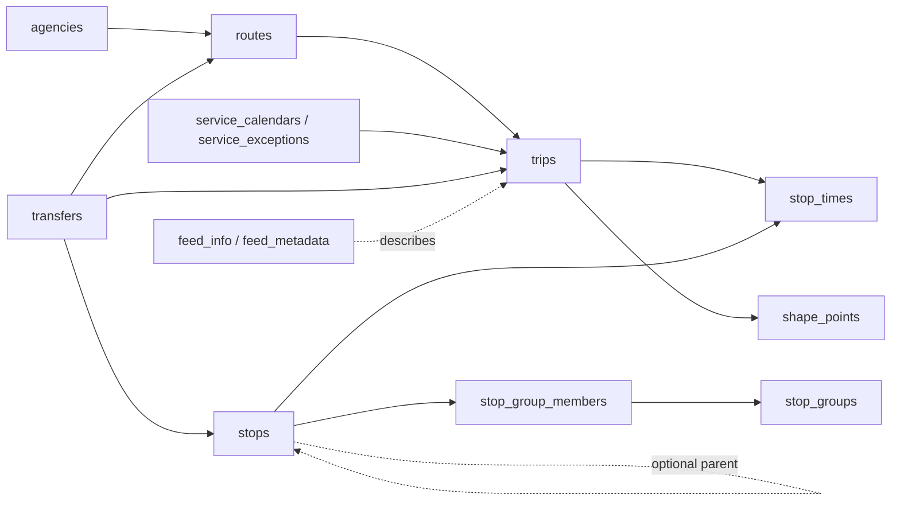

# Schedule database models

This document describes the **persisted models** in ROVAPI's SQLite schedule
database. The database is an import of a subset of [GTFS Schedule](https://gtfs.org/documentation/schedule/reference/),
plus ROVAPI's derived stop groups and search indexes. It is a static timetable,
not a record of vehicle positions or actual arrivals.

The observations and examples below come from the `nl-v6g2` Dutch feed imported
on 2026-10-13 (feed version `9632`, advertised service dates 2026-10-12 through
2026-12-12). Counts describe **that snapshot**, not every Dutch feed or a rule
about the Netherlands. IDs are illustrative source IDs from the snapshot;
another import can change them. The active database is named by
`data/active.json`, while the database itself lives under `data/schedules/`.

## How the models fit together

`source_id` is the ID from GTFS; `id` is a local SQLite integer used for some
joins. Do not treat the local integer as a stable ID across imports. Several
relationships are stored as source ID text, so a column named `*_source_id`
usually does not reference the local integer. Dates are `YYYYMMDD` integers;
stop-time clocks are seconds since the **service day's** midnight, and can
exceed 86,400. Coordinates are WGS84 latitude and longitude.

## Feed and operator models

### `feed_info` (one row)

**Summary:** Describes who published the GTFS dataset and its stated coverage.

**Explanation:** Stores publisher name and URL, feed language, optional default
language, start/end dates, source version, and contact details. Its singleton
key is always `1`. The source version is supplied by the publisher; it differs
from ROVAPI's content-based schedule version.

**Relations:** Applies to the whole database, not to a particular agency or
route. `feed_metadata` stores ROVAPI's separate import identity.

**Example:** `OVapi`, `http://www.ovapi.nl`, language `nl`, dates `20261012` to
`20261212`, source version `9632`.

**Edge cases / Dutch snapshot:** The row is optional when a GTFS feed lacks
`feed_info.txt`. This snapshot has one row but no default language or contact
details. Feed coverage dates are a statement about reliable coverage, not a
replacement for service-date rules.

### `feed_metadata` (key/value rows)

**Summary:** Records ROVAPI's identity and import time for this SQLite file.

**Explanation:** The current keys are `schedule_version` (a feed/content hash
based name) and `imported_at_unix` (Unix seconds, stored as text). This is
application metadata rather than GTFS input.

**Relations:** Describes all domain tables; `data/active.json` outside the
database selects which completed schedule file the API currently uses.

**Example:** `schedule_version = nl-v6g2-de9b91491c109d107dd0b6bf3989fd34a9ca825f1ab5c91643a62c60897ffa9f`.

**Edge cases:** A database file can be valid but inactive. Read `active.json`
to find the active one; do not infer it from the newest filename.

### `agencies` (43 rows)

**Summary:** Identifies transit operators or agencies in the feed.

**Explanation:** Each row has a GTFS `source_id`, display name, URL, and time
zone. The time zone matters for interpreting scheduled service times.

**Relations:** `routes.agency_source_id` points to an agency; routes then own
trips. One agency can have many routes.

**Example:** `ARR` is named `Arriva`.

**Edge cases / Dutch snapshot:** Operator names are not unique: the snapshot
also has `IFF:ARRIVA` named `Arriva`. Use `source_id` for identity. GTFS permits
an omitted agency ID for a single-agency feed, so other feeds may use an empty
ID rather than a recognizable code.

## Network and timetable models

### `stops` (78,252 rows)

**Summary:** Represents boarding stops/platforms and their parent stations.

**Explanation:** Stores source ID, optional public code, name, optional position,
`location_type`, optional parent stop ID, and optional platform code. A parent
is another `stops.source_id`; it describes hierarchy, not an additional trip
call. Stops are the actual locations used by `stop_times`.

**Relations:** A stop can be called by many trips, belong to one derived stop
group, have a parent station, and appear in transfer rules. `stop_group_members`
links it to a group.

**Example:** `stoparea:17843` is the `Utrecht Centraal` station
(`location_type=1`); platform/stop `2993985` has that parent and
`location_type=0`.

**Edge cases / Dutch snapshot:** [GTFS defines](https://gtfs.org/documentation/schedule/reference/#stopstxt)
`0` stop/platform, `1` station, `2` entrance/exit, `3` generic pathway node,
and `4` boarding area. This snapshot uses **only 0 (61,213 rows) and 1
(17,039 rows)**. Thus an explorer view for types 2–4 has no records in this
feed, though the model and validator support them. All snapshot stops have
coordinates, but 126 have `(0, 0)`; treat those as unusable for a Dutch map.
Other feeds can omit positions. A name need not uniquely identify a stop.

### `routes` (3,096 rows)

**Summary:** Describes a named service line and its transport mode.

**Explanation:** Stores source ID, agency ID, short and long names,
`route_type`, and optional RGB hex line/text colors. A route is a grouping of
trips, not one journey or a single geometry.

**Relations:** Belongs to an agency and has many trips; the trip's shape and
stop calls define a particular journey. Transfer rules may target a route.

**Example:** Route `162583`, Arriva line `8`, has long name
`Maastricht via Bemelen - Valkenburg` and `route_type=3` (bus).

**Edge cases / Dutch snapshot:** The snapshot has route types `0` tram (52),
`1` subway (10), `2` rail (179), `3` bus (2,832), and `4` ferry (23).
[GTFS supports more types](https://gtfs.org/documentation/schedule/reference/#routestxt),
but they are absent here. Both color fields are empty on 1,427 routes. Do not
assume a route has one shape or that its short name is globally unique.

### `trips` (1,021,703 rows)

**Summary:** Represents one scheduled journey pattern on a route and service.

**Explanation:** Stores source ID, local `route_id`, `service_source_id`,
headsign, short name, optional `direction_id`, and optional shape source ID.
The `service_source_id` chooses the dates on which the trip runs. A trip row
alone does not contain its stop sequence or times.

**Relations:** Belongs to one route and one service; has ordered `stop_times`
and optionally a polyline in `shape_points`. Transfers can refer to trips.

**Example:** Trip `390888931` is on route `162583`, service `1132`, headsigned
`Valkenburg`, with shape `1689765`.

**Edge cases / Dutch snapshot:** `direction_id` is `0` or `1` here, but those
values distinguish directions **within a route**, not universal inbound and
outbound meanings. All snapshot trips have headsign and short name; 34,360
have no shape, so a map must fall back to stops or show no line. Different
trips on one route may use different shapes and stopping patterns.

### `stop_times` (19,817,415 rows)

**Summary:** Gives each trip's ordered stop calls, scheduled times, and boarding rules.

**Explanation:** The key is `(trip_id, stop_sequence)`, where both trip and stop
are local integer IDs. Arrival/departure are stored as service-day seconds;
optional stop headsign, `pickup_type`, `drop_off_type`, and `timepoint` retain
GTFS call-level details. Sort by `stop_sequence`, not by stop ID or clock text.

**Relations:** Joins one trip to one stop per call. The same stop may occur more
than once in a trip, so `(trip_id, stop_id)` is not a key. The call's `stop_id`
must be a boarding stop/platform, not a parent station.

**Example:** Trip `390888931` calls at `Maastricht, Station Maastricht`
(`stop_id=4187790`, sequence 1) at `18:44:00`; the next call is
`Maastricht, Wilhelminasingel` at `18:45:00`.

**Edge cases / Dutch snapshot:** The first call above has `drop_off_type=1`
(no alighting), while another trip may forbid boarding at its last call.
[Pickup/drop-off values](https://gtfs.org/documentation/schedule/reference/#stop_timestxt)
are `0` regular, `1` unavailable, `2` phone agency, and `3` coordinate with
driver; all four occur in this snapshot. `timepoint=0` means approximate,
`1` exact: both occur, and most snapshot calls are approximate (17,855,098).
Some trips cross midnight: 551,959 departures are at or beyond 24:00:00,
with a maximum of 34:28:00. Keep their **service date**, rather than moving
them naively to the next calendar day's service. This snapshot has no missing
arrival/departure times, though the schema allows them.

### `service_calendars` (0 rows)

**Summary:** Defines a repeating weekly service pattern over a date interval.

**Explanation:** Keyed by `service_source_id`; Monday through Sunday are 0/1
flags, and `start_date`/`end_date` include both endpoints. A trip's service ID
can refer to this row. This is the stored form of GTFS `calendar.txt`.

**Relations:** A service can be used by many trips; `service_exceptions` can
add or remove individual dates from its weekly pattern.

**Example:** A hypothetical service `weekday` with Monday–Friday `1`, weekend
`0`, and dates `20261012`–`20261212` would run on weekdays unless overridden.

**Edge cases / Dutch snapshot:** This table is **empty** here. That is valid
GTFS: the feed uses explicit dates in `service_exceptions` instead of weekly
rules. A UI should show the service's actual dates rather than displaying an
empty weekly calendar as “no service.”

### `service_exceptions` (71,655 rows)

**Summary:** Adds or removes one service on one explicit date.

**Explanation:** The key is `(service_source_id, date)`, with
`exception_type=1` for added service and `2` for removed service. These rows
are the stored form of GTFS `calendar_dates.txt`. Dates are service dates, not
necessarily the wall-clock date of an after-midnight stop call.

**Relations:** The service ID is referenced by `trips`; when a weekly calendar
exists, the exception overrides it. When no weekly calendar exists, added
dates alone define service. [Both uses are part of GTFS](https://gtfs.org/documentation/schedule/reference/#calendar_datestxt).

**Example:** Service `1` is added on `20261011` (`exception_type=1`).

**Edge cases / Dutch snapshot:** All 71,655 rows are additions (`1`); no
removals (`2`) occur. They cover 3,189 service IDs and dates from `20261011`
to `20261212`. A generic explorer still needs to understand removals for
other feeds.

### `shape_points` (7,815,841 rows; 13,035 shapes)

**Summary:** Stores ordered geographic points for trip path polylines.

**Explanation:** A shape is the set of rows sharing `shape_source_id`, ordered
by `sequence`; each row has latitude, longitude, and optional cumulative
`distance_traveled`. There is no separate `shapes` table or shape header row.

**Relations:** `trips.shape_source_id` selects one shape; many trips can reuse
it. Shape points describe the path between calls, while `stop_times` defines
where and when passengers may board or alight.

**Example:** Shape `1689765` starts at sequence `0`, `(50.851282, 5.704333)`,
distance `0`; its next point is `(50.851246, 5.704361)`, distance `4`.

**Edge cases / Dutch snapshot:** Shape sequences need not start at 1, as this
example shows. The snapshot supplies distances for every point; other feeds
can omit them. A route can have several shapes, and some trips have none.

### `transfers` (82,216 rows)

**Summary:** Defines allowed, timed, or forbidden connections between services.

**Explanation:** A row contains from/to stop source IDs, optionally from/to
route and trip source IDs, `transfer_type`, and optional minimum transfer time
in seconds. Empty strings mean an optional qualifier was not supplied. The
compound of the six endpoint/qualifier IDs is the key, not one row ID.

**Relations:** Can narrow a rule to stops, routes, or particular trips. A stop
may be a station, in which case ordinary stop transfer rules can apply to its
child platforms. These are rules about interchange, not trip stop calls.

**Example:** A type `1` row links trip `325547990` to trip `275155180` at
stop `2992835`: the outgoing vehicle is expected to wait for the incoming one.

**Edge cases / Dutch snapshot:** [GTFS transfer types](https://gtfs.org/documentation/schedule/reference/#transferstxt)
are `0` recommended, `1` timed, `2` minimum time, `3` impossible, `4` in-seat
allowed, and `5` in-seat prohibited. Only `0` (73,119), `1` (1,137), and `3`
(7,960) occur here; all rows specify from/to trips, none specify routes, and
none have `min_transfer_time`. Do not interpret a type `3` row as a usable
connection. Another feed may use type `2` with a required minimum time or
types `4`/`5` for linked trips.

## Derived grouping and search models

### `stop_groups` (26,059 rows)

**Summary:** Provides one map/search location for stops that belong together.

**Explanation:** This is **derived by ROVAPI**, not a GTFS table. A group has
a synthetic source ID, preferred name, representative position, bounding box,
and member count. Import first joins explicit `parent_station` hierarchies,
then merges components with the same normalized name within 150 metres.
Where available, station positions are preferred for the representative point.

**Relations:** `stop_group_members` links each group to its stops. Group
details can then be enriched with routes and agencies through stop calls.

**Example:** `group:stoparea:17843` is named `Utrecht Centraal`, has 40 members,
and is centered near `(52.089451, 5.109871)`.

**Edge cases / Dutch snapshot:** Group IDs are implementation-derived and may
change if source data or grouping rules change. Two stops with the same name
need not be grouped if too far apart; a group can also have one member (2,113
such groups here). `(0, 0)` stop coordinates are ignored in group geometry.

### `stop_group_members` (78,252 rows)

**Summary:** Assigns each imported stop to exactly one derived stop group.

**Explanation:** Each row has local `group_id` and `stop_id`; `stop_id` is
unique, and `(group_id, stop_id)` is the key. This is a join table rather than
a separate public transit entity.

**Relations:** Joins `stops.id` to `stop_groups.id`; groups can contain many
stops, but each stop belongs to one group in this schema.

**Example:** Stop `2993985` belongs to group `group:stoparea:17843`.

**Edge cases:** Group membership is broader than explicit GTFS parenthood:
nearby, same-name stops may be joined even with no `parent_station` link.

### Search and spatial indexes

**Summary:** The remaining virtual tables accelerate lookups; they are not new
transport entities.

**Explanation:** `stop_search` is an FTS5 text index over stop name and code;
`stop_spatial` and `stop_group_spatial` are R-tree indexes for coordinate
queries. Their SQLite-generated `*_data`, `*_idx`, `*_content`, `*_docsize`,
`*_config`, `*_node`, `*_parent`, and `*_rowid` tables, plus `sqlite_stat1` and
`sqlite_stat4`, are implementation/optimizer storage.

**Relations:** Index rows mirror `stops` or `stop_groups`; use the domain tables
for records and the indexes for text or bounding-box searches.

**Example:** A search for `Utrecht Centraal` can use `stop_search`, then resolve
matching stop IDs to `stops` and their group memberships.

**Edge cases:** Index rows are not a source of GTFS truth and should not be
edited independently. R-tree bounds use floating point approximations, so
geographic queries should apply an exact final distance/bounds check where
precision matters.

## What this database does not model

The importer stores the GTFS files represented above. It does **not** persist
the full GTFS Schedule specification: fares, pathways, levels, frequencies,
translations, accessibility fields, and several other optional fields/files
are outside the current schema. Their absence here is a **ROVAPI coverage
limit**, not evidence that they are irrelevant to Dutch public transit. In
particular, types 2–4 of `location_type` describe station interiors and could
be useful in a future feed even though this snapshot does not contain them.
Real-time vehicle locations, delays, and cancellations are also outside this
static database.

For the exact field constraints and indexes, see the SQL in [`migrations/`](migrations/).
For the source-to-storage mapping, see [`src/gtfs/records.rs`](src/gtfs/records.rs)
and [`src/storage/sqlite.rs`](src/storage/sqlite.rs).
